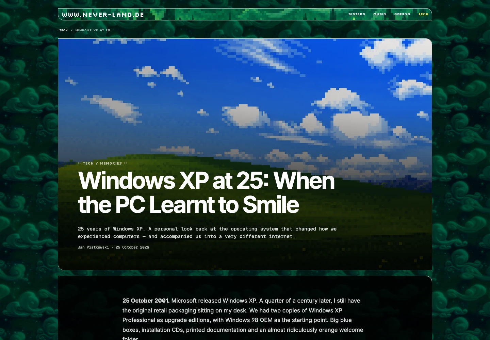
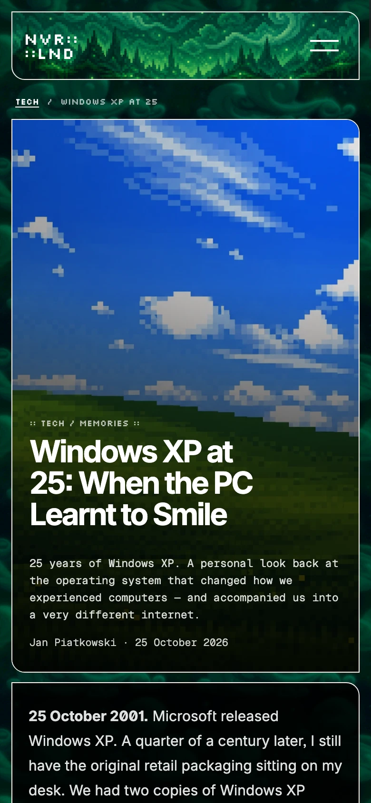
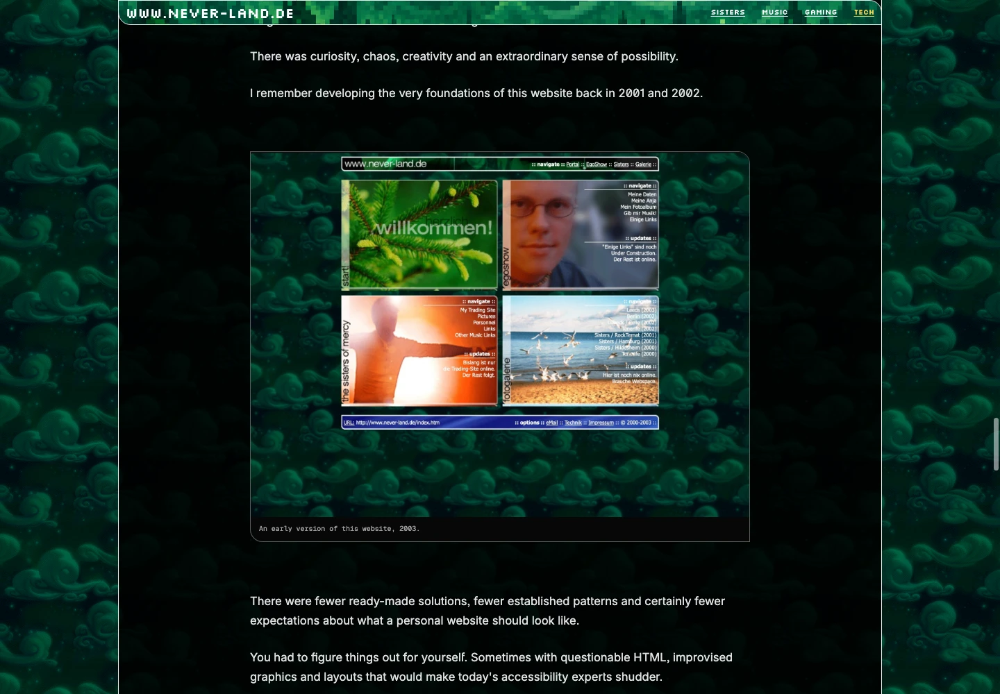
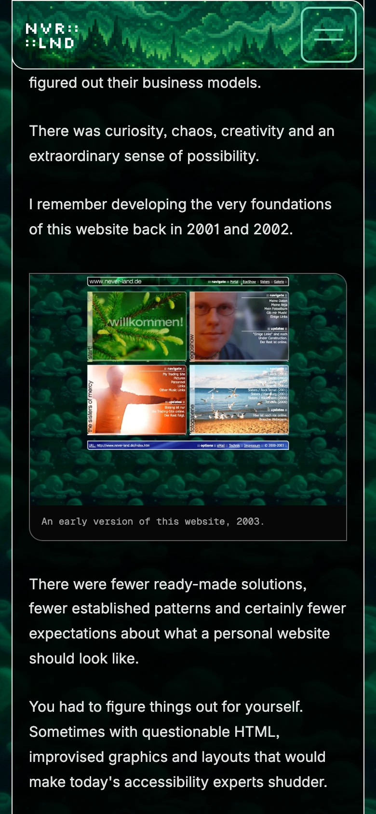
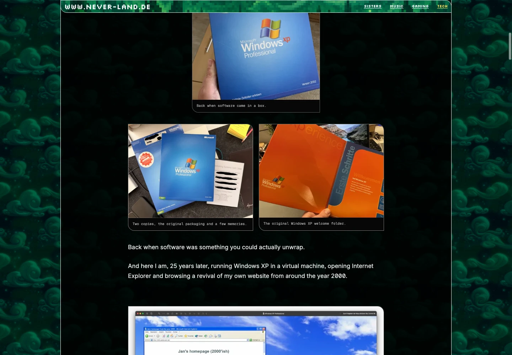
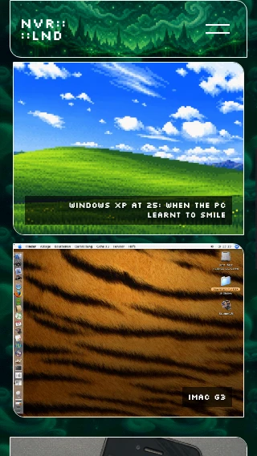

# Windows XP at 25 — local visual acceptance

The article has passed visual review and is approved for main. The historical image issue is resolved, the Bliss hero spans the article width, and the reading panel is subtly translucent. No production deployment has been performed; deployment remains manual.

## Preview and implementation

- [Local article preview](http://127.0.0.1:8000/tech/windows-xp-at-25-when-the-pc-learnt-to-smile.html)
- [Article source](../tech/windows-xp-at-25-when-the-pc-learnt-to-smile.html)
- [TECH styles](../css/tech.css)
- [Browser and static QA results](windows-xp-25/qa-results.json)

The existing static HTML architecture, shared editorial components, typography, panel borders and asymmetric corners are retained. The article's 1,786-word body, eight sections, title, kicker, dek and author/date metadata remain unchanged. The TECH teaser and social metadata retain the Pixel-Bliss cover.

## Changes

**Historical website image.** The article now directly references the existing `options/never-land-2003.jpg`, already used by `options/technik.html`. It appears immediately after “I remember developing the very foundations of this website back in 2001 and 2002.” in “We were pioneers”, with the caption “An early version of this website, 2003.” The image opens its existing full-size URL and has descriptive alt text, explicit 1813 × 1326 dimensions and lazy loading. No new copy or replacement screenshot was created. The duplicate at `essentials/options/never-land-2003.jpg` is byte-identical; the URL already used elsewhere was chosen. Both originals remain unchanged. The earlier TODO is removed.

**Reading panel.** The article-specific background is `rgba(0, 0, 0, 0.85)`, with `backdrop-filter: none`. The green swirls show through softly without a glass effect. Existing text colours, spacing and borders are preserved. The change is scoped to the XP article.

**Bliss hero.** The split layout is replaced by the shared Gig Reviews composition: a full-width image, an overlaid gradient shade and bottom-aligned text inside the same panel. The image uses `object-fit: cover` and `object-position: center 45%`. A gentle-to-dark gradient protects the title and small metadata while leaving the sky and horizon visible. All supplied headline metadata remains in place.

**Responsive refinements.** The hero scales between 560 and 680 pixels high on larger screens, and uses 580 pixels below 700 pixels wide so the complete text remains within the composition. The mobile title scales from 2 to 3 rem. Responsive image `sizes` reflects the full desktop width and the minimum effective image width needed for the taller phone crop. Images, gallery spacing and the original iMac page retain their existing behaviour.

## Checks

| Check | Result |
| --- | --- |
| Build / lint / typecheck | This static HTML project has no separate build, lint or typecheck command. The final files were served and verified directly. No dependencies or build infrastructure added. |
| Editorial copy | Full body matched against the authoritative `ARTICLE.md`: 1,786 words unchanged. |
| Markup / metadata | Balanced HTML, unique IDs, one H1, eight H2 headings, valid JSON-LD, original date and `en-GB` language verified. |
| Media / links | All 63 local references and responsive candidates resolve. Seven images total: one Bliss hero, five supplied editorial images and the existing 2003 website image. |
| Originals | All six supplied originals and the existing 2003 screenshot remain unchanged by SHA-256 comparison. |
| Existing function tests | `node --test tests/station.test.mjs`: 13/13 passed. |
| Existing link checks | `python3 tests/station_links.py`: 3/3 passed. |
| Article browser QA | Chrome at 1440 × 1000, 768 × 1024, 390 × 844 / DPR 2 and 320 × 568: no horizontal overflow, full-width hero, text inside image bounds, all images loaded. |
| Panel treatment | Browser-computed background is exactly `rgba(0, 0, 0, 0.85)` and backdrop filter is `none` at all four sizes. |
| Position and behaviour | Existing 2003 asset is immediately after the required sentence. Mobile menu, Escape/focus restoration, keyboard skip link, TECH teaser/back links and unchanged iMac cover behaviour pass. |
| Errors | No browser exceptions, HTTP errors, failed requests or external requests in the article check. |
| Patch | `git diff --check` passed; unrelated existing work preserved. |

Desktop, tablet and phone screenshots were visually inspected for contrast, title wrapping, horizon placement, panel translucency and consistent image frames. No content or layout issue remains open. Safari and real mobile hardware were not tested.

## Visual evidence

### Desktop · 1440 × 1000

### Mobile · 390 × 844, DPR 2

### Existing 2003 website image · desktop

### Existing 2003 website image · mobile

### Packaging and panel translucency

### Existing TECH teaser

## Revision files

- `tech/windows-xp-at-25-when-the-pc-learnt-to-smile.html`: existing historical image, shared hero shade and updated responsive source sizes.
- `css/tech.css`: article-scoped hero and translucent panel refinements.
- This report and `docs/windows-xp-25/`: refreshed screenshots and QA results.

The complete original PNG screenshots and browser results are in `/tmp/never-land-windows-xp-25-revision-qa/`; the temporary Chrome QA script is `/tmp/windows-xp-browser.mjs`. For a local server restart from the repository root: `python3 -m http.server 8000 --bind 127.0.0.1`.
